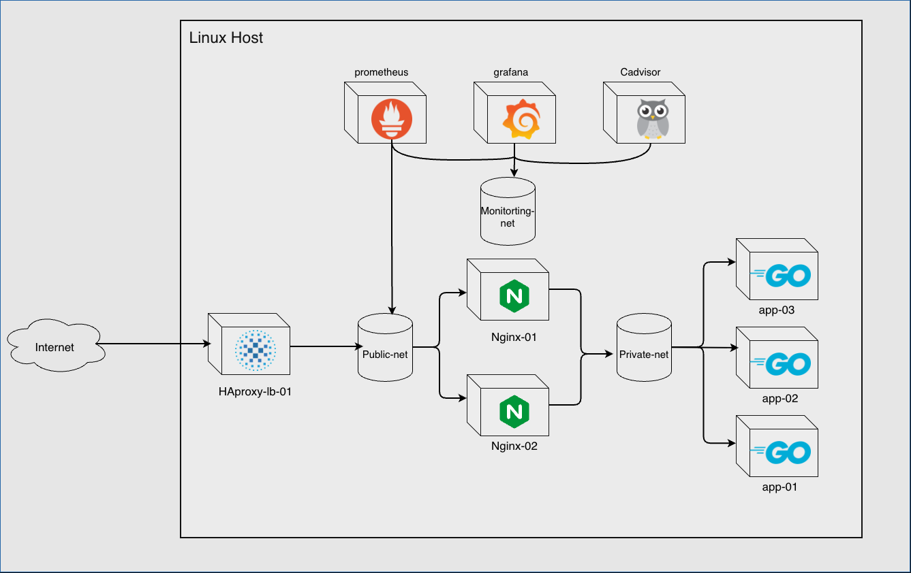
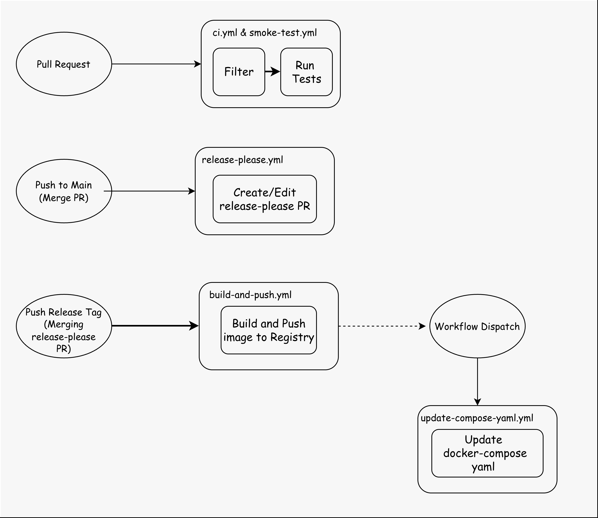
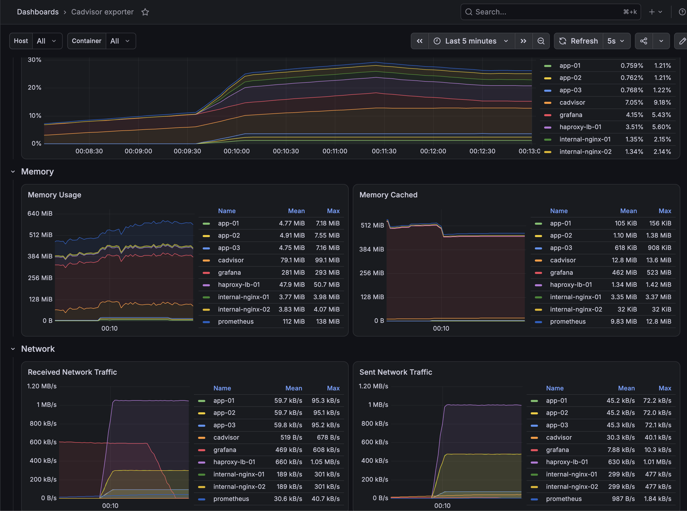
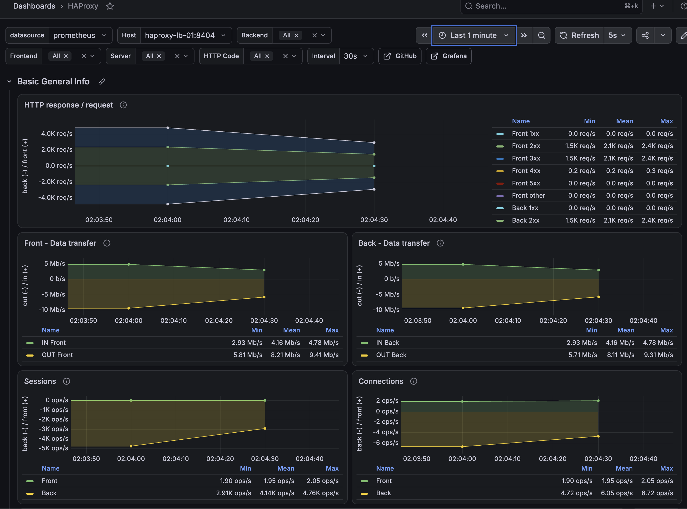
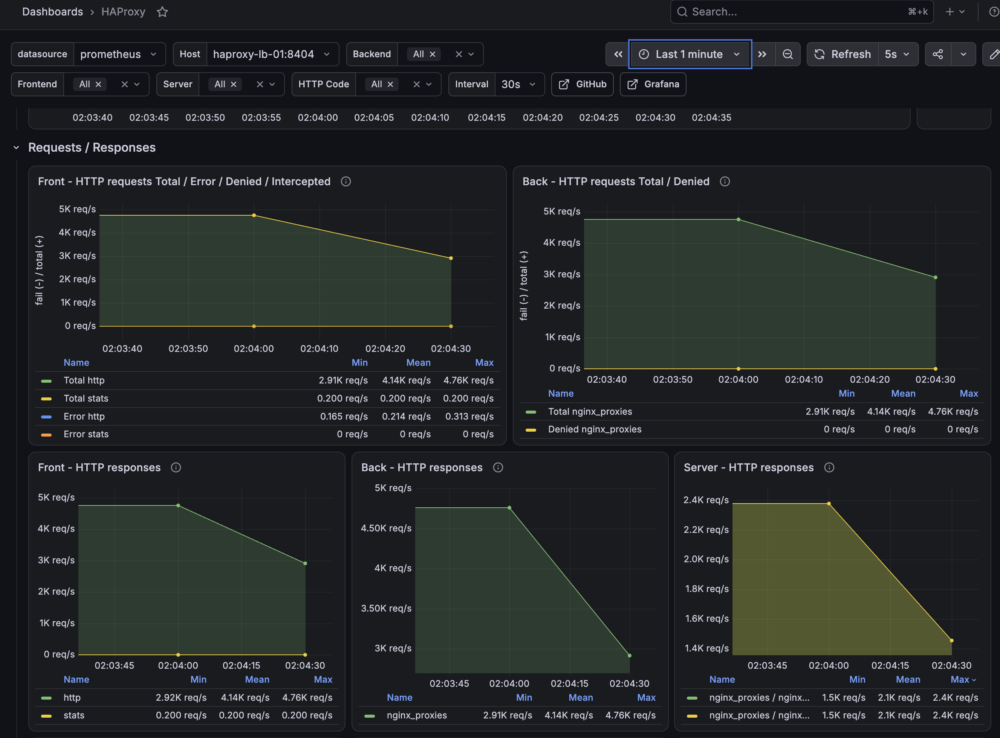

## Overview

This project features a multi tier containerized architecture where an HAProxy edge load balancer distributes incoming traffic to Nginx reverse proxies, static content delivery while forwarding API calls to an isolated pool of Go backend instances. System health and container metrics are tracked via Prometheus, Grafana, and cAdvisor, with continuous deployment and automated versioning managed by GitHub Actions and Release-Please.

The goal of this project is to practice how would an on-premise production system deployment would look like. Specially the traffic routing part. As well as practicing system design and DevOps tools. such as Github actions for ci/cd piplines, Prometheus and Grafana for Observability and monitoring, as well as learning how to setup traffic routing nodes.

NOTE: This project is not production ready by any means. The project's main objective is to learn how to approach such type of deployment and some of the associated technologies.

## Project Objectives

- Learn how to design networks, isolate tiers, and not leave a node unnecessarily exposed
- Learn how to setup load balancers and implement one at the edge while ensuring high availability
- Learn how to setup reverse proxies and offload repetitive work to them
- Learn how to design and build robust CI/CD pipelines that tests new changes, then builds and pushes the made artifacts after successful merges
- Learn how Monitoring and Observability tools work and implement them

## Technology Stack

| Technology     | Purpose                                                      |
| -------------- | ------------------------------------------------------------ |
| Docker Compose | The container orchestration tool                             |
| GitHub Actions | Continuous integration and deployment automation             |
| Act            | Testing gh actions workflows locally before deploying        |
| HAProxy        | Traffic load balancer                                        |
| Nginx          | Reverse proxy and API gateway                                |
| Go-lang        | Backend application language                                 |
| Cadvisor       | Containers monitoring agent                                  |
| Prometheus     | Scrapes the cadvisor exposed endpoint and stores the results |
| Grafana        | Queries Prometheus continuously and visualises the results   |

## Project Structure

```
.
|── backend/
│   └── go-api/    # Simple hit counter API
│       ├── Dockerfile
│       ├── go.mod
│       └── main.go
│
|── CHANGELOG.md    # Generated by GitHub bot after merging Release Please PR
|── docker-compose.staging.yml  # Used to test the latest code changes in staging
|── docker-compose.yml     # Main docker compose file
│
|── haproxy/
│   └── haproxy.cfg    # HAProxy load balancer Configuration
│
|── .env.example     # Environment variables examples
│
|── nginx/
│   |── nginx-conf/
│   │  └── default.conf     # Nginx reverse proxy configuration
│  └── static/
│       └── favicon.ico  # Browser icon served by Nginx
│
└── prometheus/
   └── prometheus.yml     # Prometheus scraping and monitoring configuration

```

## Architecture



So an http GET request lifecycle that tries to reach the root "/" would look like this:

1. The request would first reach the load balancer on port 80, which would then forward it to the Nginx reverse proxy. However, if the request includes a /health endpoint, it would be dropped by the load balancer.
2. Nginx then receives the request, and since the app only lives on the /api endpoint it redirects with a 302 code to /api (I know this is not a good design and wasted bandwidth but it was used to understand reverse proxies and browsers behaviour)
3. Then the request reaches one of the Go apps on the /api endpoint, increments the hit counter, then returns to the client.
   Also, if a request asks for /favicon (which is any request done through a browser), the Nginx will be the one to serve the icon.

### Network Design

I configured three (auto-assigned subnets) Docker networks: public-net, an isolated private-net, and monitoring-net.
The application instances reside within private-net that has no internet access, and receive traffic exclusively from the Nginx reverse proxy, which bridges both private-net and public-net. While the remaining monitoring tools live on monitoring-net, Prometheus is also attached to the public network so it can scrape the HAProxy /metrics endpoint. Although I considered modifying Linux iptables to route traffic across the boundary, Docker documentation strongly advises against altering auto-generated Compose iptables rules. Instead, I attached the container directly to the Public network.
Also, exposed ports are only bound to the localhost address, so it can be accessed only through the host machine.

## CI/CD Pipelines Design



A Pull Request lifecycle would look something like this:

1. A developer makes a PR, a filtering job starts and checks if the Go api code was modified. If so, it runs a lint and unit tests job. Also, smoke-test runs on any change made to the repo, except changes to .md files. (I could have made smoke-test runs after merging, but doing it this way made it possible to catch config bugs early before merging)
2. After a developer's PR is merged, release-please workflow triggers and creates/edits a PR that lists the made out changes and appends them to CHANGELOG.md
3. Whenever release-please PR is merged, it increments the version number mentioned in the .release-please-mainfest, and pushes that number as a tag to the main branch.
4. Following the Gitops framework, in the same build-and-push workflow it dispatches update-compose-yaml workflow to update the image version to the new version.
   Lastly, the workflows was made in a way to make it possible to be executed locally using act without accidentally pushing build artifacts. An event payload example was included in .github/act-test-envs to make it easier for the devops team to test workflows quickly.

## Monitoring & Observability

The monitoring stack used is: Cadivsor, Prometheus, and Grafana.
Cadvisor hooks into the underlaying OS and exposes a /metrics endpoint. Prometheus scrapes that endpoint on a specified interval (5s was my preferred interval) and stores the results in a database. Grafana queries that database on demand using PromQL, and visualises the results according to the customized dashboard.

As for service exporters, I made one for the load balancer. Separate ones will be made for each service in the future.

### Containers Metrics Dashboard



The dashboard displays all metrics regarding containers consumption. The main metrics being: cpu usage overtime, presented as a percentage. How much memory each container is using and how much each container is caching. Network traffic, how much data each container is receiving and sending

### HAProxy Dashboard

HAProxy has a built-in Prometheus exporter exposed through /stats endpoint. Which allows Grafana to query that endpoint directly without the need to setup a separate Prom exporter.



These are screenshots of the HAProxy stats dashboard. The dashboard include many other metrics, but the main ones being: the total number of http requests/responses. the number of ok (2xx) responses, redirect (3xx) responses, and other http codes. Data transfer in Mb/s. HTTP requests/response details, and so on.

## Learned Lessons & Skills Acquired

- Network design and isolating each tier properly
- Github repo policies and which ones are necessary for a secure software development lifecycle
- Pull requests lifecycle and properly handling merges
- Designing CI & CD pipelines
- HTTP headers/codes and when to use each one
- Gitops Framework/Practices
- Writing workflows yamls in a way that aligns with GitOps framework
- Hooking system monitoring tools and properly visualising meaningful results

## Future Work

- Setup a Prometheus alert manager
- add redundancy to the lb by spinning another one and use a virtual ip to alternate between them incase one fails
- add multi architecture image builds to the cd pipeline
- add node exporters to go backend and nginx. (Only one was setup for haproxy lb)
- Add more headers to http responses
